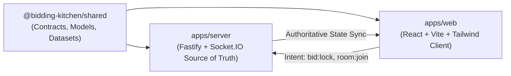
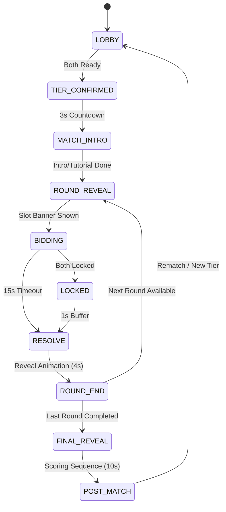

# Bidding Kitchen — Architecture Specification

## 1. Monorepo Structure

The project is organized as a high-performance `pnpm` workspace monorepo:

```
bidding-kitchen/
├── packages/
│   └── shared/          # Pure TypeScript contracts, models, state machine & canonical data (0 dependencies)
├── apps/
│   ├── server/          # Fastify + Socket.IO authoritative realtime game server
│   └── web/             # React + Vite + Tailwind mobile-first client application
```

## 2. Shared Contracts as Single Source of Truth

- `@bidding-kitchen/shared` has zero runtime dependencies on Node.js or browser DOM (`"dependencies": {}`).
- All models, event signatures, error codes, and canonical dataset arrays are imported by both server and client.
- Strict TypeScript configuration (`strict: true`, `noUncheckedIndexedAccess: true`) guarantees type safety across the network boundary.



## 3. Realtime Network Protocol

- **Transport**: WebSockets powered by Socket.IO with JSON serialization.
- **Client Intents**:
  - `room:create`, `room:join`, `room:reconnect`, `room:leave`
  - `lobby:select_tier`, `lobby:ready`
  - `bid:lock` (includes `roundIndex`, `ingredientId`, `amount`, `idempotencyKey`)
  - `post_match:rematch`, `post_match:new_tier`
- **Server Events**:
  - `match:state_sync` (authoritative `PublicMatchView`)
  - `round:player_locked` (notifies that opponent locked without leaking choice)
  - `round:resolved` (reveals both locked bids, collision outcome, and dish updates)
  - `match:forfeited`

## 4. State Machine Transition Lifecycle



## 5. Security & Anti-Cheat Invariants

1. **Information Encapsulation**: Opponent locked bids and amounts are stored in `privateBids` on the server and never emitted over the wire until `RESOLVE` is triggered.
2. **Secret Orders**: A player's private `CustomerOrder` is never broadcast to the opponent.
3. **Budget Authoritativeness**: Budget balance and spend deductions are calculated purely on the server; client bid submissions are verified against current server balance.
4. **Deterministic Seed**: The match PRNG seed is initialized server-side on match creation to resolve coinflip tiebreakers deterministically.


---

## 6. UI Action Props -> Socket Event Contract Mapping (Phase 4 / Phase 5)

In Phase 4, all screen and game components are pure, prop-driven interfaces with explicit callback props. In Phase 5, the live Socket.IO client store simply forwards these exact callback signatures into server client intents:

| Screen / Component | UI Action Prop | Type Signature | Phase 5 Socket Event Intent |
| :--- | :--- | :--- | :--- |
| `LandingScreen` | `onCreateRoom` | `(nickname: string) => void` | `socket.emit('room:create', { nickname, tier: 'STREET' })` |
| `LandingScreen` | `onJoinRoom` | `(code: string, nickname: string) => void` | `socket.emit('room:join', { code, nickname })` |
| `LobbyScreen` | `onToggleReady` | `() => void` | `socket.emit('lobby:ready', { ready: !isReady })` |
| `LobbyScreen` | `onSelectTier` | `(tier: TierId) => void` | `socket.emit('lobby:select_tier', { tier })` |
| `LobbyScreen` | `onLeaveLobby` | `() => void` | `socket.emit('room:leave', {})` |
| `AuctionRoundScreen` | `onLockBid` | `(ingredientId: string, amount: number) => void` | `socket.emit('bid:lock', { roundIndex, ingredientId, amount, idempotencyKey })` |
| `PostMatchScreen` | `onRequestRematch` | `() => void` | `socket.emit('post_match:rematch', { accept: true })` |
| `PostMatchScreen` | `onNewTier` | `(tier: TierId) => void` | `socket.emit('post_match:new_tier', { tier })` |
| `PostMatchScreen` | `onReturnHome` | `() => void` | `socket.emit('room:leave', {})` |
| `ConnectionBanner` | `onReconnect` | `() => void` | `socket.emit('room:reconnect', { playerId, matchId })` |
